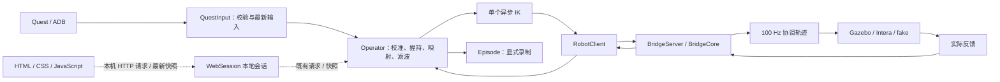

# 架构

A 是输入与数据端，B 是动作执行端。界面只发用户请求和显示快照，不拥有控制循环。
当前各执行路线与方案日志的解释见 [当前遥操方案](CURRENT_TELEOP_METHOD.md)。

## 代码地图

全部产品模块位于 `src/sawyer_teleop/`，按职责命名，当前不为目录形式迁移控制代码。

| 层 | 模块 | 拥有的职责 |
| --- | --- | --- |
| HTML 界面 | `web_server`、`web_session`、`web/` | 本机 HTTP、临时授权、单网页操作权、会话生命周期、状态与录制表单；调用同一个 Operator |
| 显示计算 | `display_feedback` | 只读实际反馈与模型验证、FK、有效期；供 HTML 姿态面板使用，不求 IK |
| 操作会话 | `operator` | 握持/校准/回中/录制状态，单个 IK 任务，失败取消 |
| 输入 | `quest`、`quest_connection`、`input_status` | USB 发现、真实输入与时钟、展示用状态；原始入口仅录制时保存 |
| 安装 | `quest_install` | CLI、ROG 与 Windows 共用 APK 校验、宿主 adb 选择和设备版本确认；不在遥操路径执行 |
| A 计算 | `motion`、`local_ik`、`kinematics_model` | 位姿滤波、连续 IK、模型和 FK；不接管 B 的执行权限 |
| A 通信 | `client`、`transport`、`protocol` | 会话、反馈与回执、最新目标槽、时钟映射 |
| B 服务 | `server`、`bridge` | 能力协商、会话代次、校验、100 Hz 提交与取消 |
| B 轨迹 | `trajectory`、`motion_profiles` | 受限协调轨迹；选项只选择现有参数 |
| B 适配 | `gazebo_backend`、`gazebo_scene`、`intera_backend`、`intera_cartesian`、`backends` | 仿真/真机/软件反馈与执行；Gazebo 场景还原 |
| 数据 | `recording`、`cameras`、`dataset`、`motion_report` | 有界异步写盘、导出、只读分析 |
| 策略 | `policy_env`、`robomimic_env` | 独立 Gazebo 策略接口，不在普通遥操路径加载训练依赖 |
| 诊断/规则 | `monitor`、`feedback_log`、`feedback_diagnostics`、`pause`、`a_timing`、`neutral`、`gripper` | 有界状态快照/持久反馈和实际方案、时间/暂停说明、回中和夹爪约定 |

## 线程与状态所有权

| 工作 | 所属线程 / 所有者 | 边界 |
| --- | --- | --- |
| HTML 状态与请求 | 有界本机 HTTP 工作线程 / WebSession 监视线程 | 100 ms 快照；重复操作不重放；3 秒页面失联结束自己的 Operator；连接与收尾后台完成 |
| HTML 三维显示 | 浏览器 canvas | Live status 下方默认折叠；展开才请求模型/实际反馈 FK 帧，过期冻结，客户端期限保守扣除请求往返耗时 |
| 输入读取/时钟同步 | Quest 线程 | 最新输入在锁下交换；重复包不续期 |
| 操作状态机 | Operator 控制线程 | 用户请求排队；只保留一个 IK future |
| IK 求解 | 单工作线程 | 结果派发前重验原输入、原引用和 generation |
| TCP 读写 | 独立 reader/sender | 目标/状态各一个 latest 槽；回执可靠且有界 |
| B 执行 | Bridge 控制循环 | 每次提交重新校验；100 Hz 不等待 ROS 场景服务 |
| 场景恢复 | B 独立任务 | 已 hold 且 neutral，Stop/断线取消，保持 /clock 连续 |
| HDF5/视频 | Episode 单写盘线程 | 队列满明确失败，普通遥操不写盘 |

控制、录制、展示三种状态独立：暂停日志只冻结显示；结束录制不自动停止遥操；松手暂停运动但录制可继续。
录制写入与收尾分开：收尾逐一关闭资源，即使关闭失败也完成状态通知；未确认关闭的数据留在 `.pending_*` 待恢复。
ROG 与 Windows 仿真启动共用 `initialize_gazebo_scene.py`；旧 Windows 文件只保留兼容入口。

## 数据语义

`手柄原始输入 → 映射/平滑目标 → IK 关节目标 → B 提交参考 → 实测反馈` 分别保存和解释。
目标收到不等于提交，提交不等于到位；日志展示和导出都不覆盖原始值。
详细字段见 [DATASET](reference/DATASET.md)，消息见 [PROTOCOL](reference/PROTOCOL.md)。

## 执行路径

| 后端 | IK | 提交方式 | 状态 |
| --- | --- | --- | --- |
| Gazebo | A 本地，或显式远端 | TRAJECTORY_MODE，q/dq/ddq | 当前实测；支持仿真快速参数与场景恢复 |
| Intera | 远端官方服务 | POSITION_MODE，q | 真机未验收；本地 IK 和仿真快速参数不可用 |
| Intera Cartesian（显式选项） | 远端官方服务，B 另用 SDK FK | 原生 MotionTrajectory(CARTESIAN)，10/20/50/100 Hz 目标节拍 | 离线验证候选，真机待现场；单 FK 线程仅准备，B 控制线程负责发送/STOP |
| fake | 远端软件求解 | 软件反馈 | 通信/流程测试，不是物理证据 |

各遥操执行路径共用可协商的 [关节跳变保护](JOINT_PROTECTION.md)：A 校验 IK 解与发送目标，
B 校验远端 IK、接收目标和实际提交，首次参考来自 arm 的新鲜反馈，后续使用通过检查的前值。
默认 0.35 rad 逐关节上限；最新槽丢弃中间目标后仍必须通过 B 提交检查。
这是目标连续性检查，不能代替原生控制器内部轨迹或实际跟随的验证。

## 维护原则

- 重构先选清楚的边界：如录制面板、日志面板；不同时拆控制状态机与改算法。
- 参数表从配置/握手读取；GUI 不创造另一套保护或时限。
- 每个跨线程边界保留时效复验；“代码重复”不意味着可以删除检查点。
- 优先减少状态与隐式依赖，不增加通用事件总线、插件层或第二个任务调度器。
- `Operator.tick` 保留显式的停止、录制、反馈、握持和 IK 顺序；不为缩短函数引入新的状态机框架。
- 产品代码在 src，固定回归在 tests/fixtures；实验数据与原始录制不入库，实验不自动进入运行版。

运动约束与理由见 [运动设计](reference/MOTION_CONTROL_DESIGN.md)，日志与诊断见 [TROUBLESHOOTING](TROUBLESHOOTING.md)。
