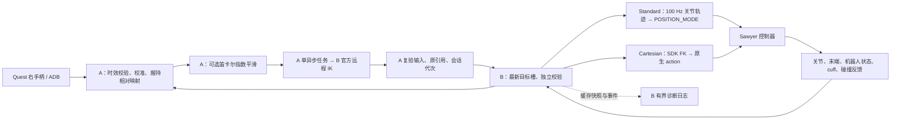

# 当前遥操方案：A / B 分工与日志识别

记录日期：2026-10-29。以本次核对的 `sawyer_teleop/` 主源码为准；实际运行方案以 B 日志
`last_arm_configuration` / `control_configuration` 事件为准，配置文件不能证明运行中已加载。
本页解释技术方案；状态与验证进展见 [PLAN](PLAN.md)，操作入口见 [USAGE](USAGE.md)。

## 主链路

本机 Web 操作台调用 Operator 状态机。界面、三维显示和日志显示不拥有运动执行权限。
控制端口 8765、IK 端口 8766 是实验室配置；仿真端口可不同。目标/状态采用最新槽覆盖，
IK 只有一个工作线程，不积压旧目标或补发错过的控制周期。

## A：把手柄动作变成机器人目标

1. Quest App 输出 protocol 3 数据，经 ADB 读取；检查会话、递增序号、采样时刻、追踪和前台状态。
   APK 清单请求 120 Hz，但不能据此认定现场输入或机器人执行达到 120 Hz。
2. 操作者朝机器人 base +X 校准朝向；右手柄握持后，以当时机器人实测位姿和手柄位姿建立相对锚点。
   B 确认 arm 后重新获取并验证输入，避免复用确认前已过期的 Quest 样本。
3. 位置目标为 `p_target = p_robot_anchor + scale · M · (p_vr − p_vr_anchor)`；
   姿态为 `R_target = M · R_vr · R_vr_anchorᵀ · Mᵀ · R_robot_anchor`。
   `M` 为校准映射，默认位置比例 1.0。重新握持建立新锚点。
4. 可选单层指数平滑：`α = 1 − exp(−Δt/τ)`，位置线性更新，旋转沿最短旋转弧更新；
   Light τ=20 ms、Heavy τ=40 ms、DROID-like τ=150 ms（实验档，接近 DROID 等效约 142 ms 的低通）。按 Quest 采样间隔计算，不按到包抖动重复滤波。
5. 真机使用 B 的官方 IK 服务，完整传递位置、姿态和七关节种子；启用平滑/轨迹/保护时通常沿用前一个
   有效目标作种子。A 的一个异步任务等待求解，返回后复验原输入、原反馈引用和 generation，再发送关节目标。
   Gazebo 才可显式使用 A 本地 IK；真机界面会强制选择 remote，B 也拒绝本地 IK 目标权限。

## B：两种主源码执行路线

| 选项 | 实际行为 | 边界 |
| --- | --- | --- |
| Standard | B 在 100 Hz 循环内用配置指定的关节轨迹生成参考；当前配置为 Ruckig `coordinated`，真机只发布 POSITION_MODE 的 q | A 输入平滑与 B 轨迹职责不同；内部控制器伺服频率不等于外部给点频率 |
| Intera Cartesian 10/20/50/100 Hz | A 仍先远程 IK；B 单线程异步用 SDK FK 将 q 转为 waypoint，由控制循环提交原生 CARTESIAN action | 不是绕过 IK；目标提交节拍不保证物理运动或 action 平滑衔接 |
| Fast follow | Gazebo 专用加速度参数档，复用现有关节轨迹算法 | 真机不可用，不把仿真手感当真机证据 |

Standard 的当前模板速度上限为 `[0.8,0.8,1.0,1.0,1.57,1.57,1.57] rad/s`，
加速度为 `[1.5,1.5,3,3,3,3,3] rad/s²`；跟随误差阈值 0.5 rad。
这些是配置/软件参考限制，不是硬件安全认证或对真实跟随性能的保证。
Cartesian 默认 SDK 选项为线速度/加速度 0.6/0.6、角速度/加速度 1.57/1.57、关节速度比例 1.0；
实际 B 参数可由 ROS 配置覆盖，应以日志记录的协商值为准。

## 期限、保护与恢复

| 约束 | 主真机路径数值 / 行为 |
| --- | --- |
| Quest 原输入 | 200 ms（2026-10-29 起，原 150 ms）；含时钟不确定度检查，旧样本不得重新续期 |
| 远程 IK / A 任务 | 80 ms 求解请求预算 / 100 ms 整个任务寿命；不是可相加的独立宽限 |
| B 最新反馈 / 原反馈引用 / 命令 | 100 / 120 / 200 ms；每次提交重新检查 |
| 目标关节跳变 | 勾选保护时 A/B 独立检查，每关节 0.35 rad；与跟随误差或硬件位置限位不同 |
| 跟随误差 | 当前模板 0.5 rad；10-26 早期日志的 0.35 rad 是旧配置，不改写历史 |
| 松手、追踪丢失、过期、断线 | 暂停并丢弃在途目标，generation 失效；正常条件恢复后需松手重握，必要时重连/校准 |
| 原生 Cartesian STOP | 要确认停止；2 秒确认超时/失败会锁住 B，不能靠重连 A 或切换 joint 绕过 |
| 控制器故障 | B 拒绝 stopped/error/未使能等状态；本软件不自动 fault reset 或 enable |

Reset arm 是回到命名 neutral 的受限 cubic 关节运动，速度/加速度均取 A 基准的 25%，
不是故障复位。neutral 在 B 握手读取，当前本地 YAML 为实验室确认的七关节姿态；
远端快照缺少后续本地 neutral 更新，不能假定现场使用同一目标。

## 当前文件与运行版本必须分开

| 核对对象 | 本次看到的内容 |
| --- | --- |
| 主源码 `config/operator.json` | Gazebo 模板，120 Hz A，Light 20 ms，coordinated 轨迹，关节跳变保护开启 |
| Windows 本机 `windows-local/config/operator.json` | 保存为 intera / Standard / 20 ms / 120 Hz / 跟随误差 0.5；关节跳变保护关闭；这是保存值，不是当前进程状态 |
| 本机保存的 `ik_mode=local` | 是保留的 Gazebo 偏好；GUI 连接 intera 时实际强制 remote，不能只看 JSON 下结论 |
| 远端 `Lin/B-Lab-Ubuntu` | 10-29 已只读取回并核对的旧部署，反馈兼容修复已合入本地主源码；新持久日志与方案记录还未部署 |
| 独立 `sawyer_teleop-direct-pose-50hz/` | 另一候选：A 直接发映射/平滑后的位姿，B 50 Hz 原生 Cartesian，跳过 IK/FK；未并入主源码，未据此认定现场已采用 |

## 如何从日志认出“当时实际用了哪套”

B 每次成功 arm 都生成 `control_configuration` 事件，正常反馈日志同时携带
`state.last_arm_configuration`，包含 session、generation、B 单调时刻、参数 SHA-256 和：

- backend、tip frame、execution_mode、control_hz、motion_purpose；
- 实际 joint trajectory 算法与全部规范化参数，或实际 Cartesian 选项与协商发送频率；
- 关节保护开关/阈值，B 三项时效预算和本地模型 SHA（如适用）。

它在 hold/断连后保留为**最后一次成功 arm 的方案**；只有 armed=true 才表示当前仍获准执行。
故障回看必须结合 session/generation、armed、反馈有效性和 reason，不能把旧方案当作正在运动。
B 不知道 A 当时的平滑档位、位置比例、Quest 实际输入频率等完整配置，所以本记录不臆造这些值；
A 的显式 episode metadata/engaged 输入与锚点可补充，未录制时不保证可事后重建。
持久日志位置、容量和开启方式见 [TROUBLESHOOTING](TROUBLESHOOTING.md#b-反馈诊断日志实机)。

源码定位：`operator.py` / `motion.py` / `quest.py` / `client.py` 是 A 主链，
`bridge.py` / `trajectory.py` / `intera_backend.py` / `intera_cartesian.py` 是 B 主链，
`feedback_log.py` / `cli.py` 负责有界诊断落盘；均位于 `src/sawyer_teleop/`。
